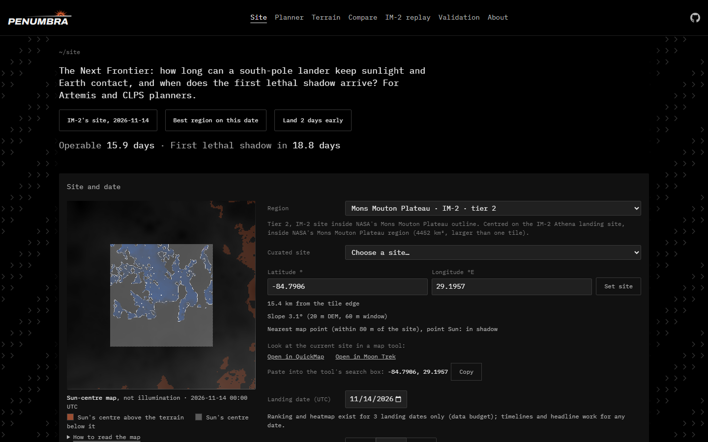
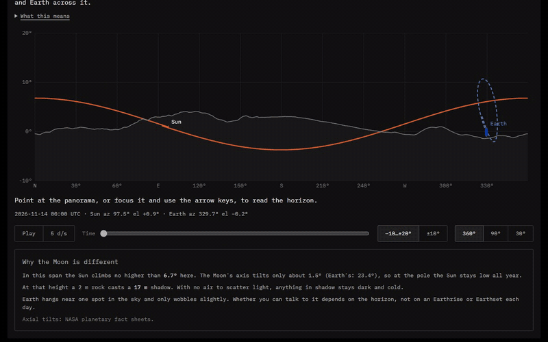
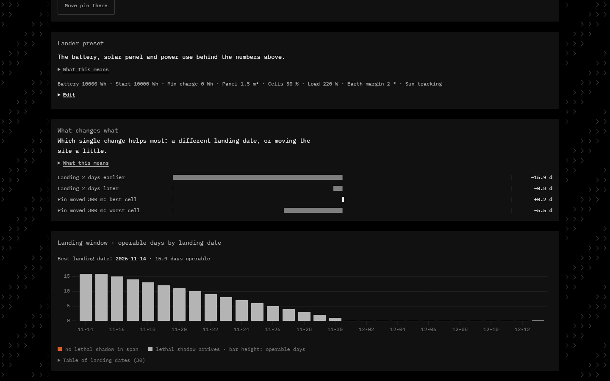
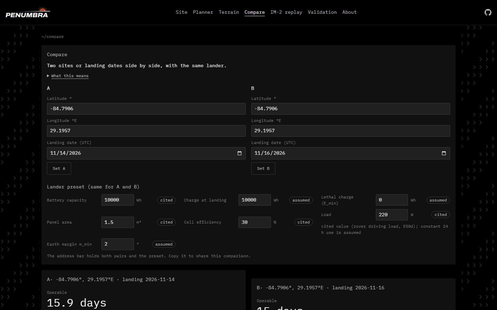
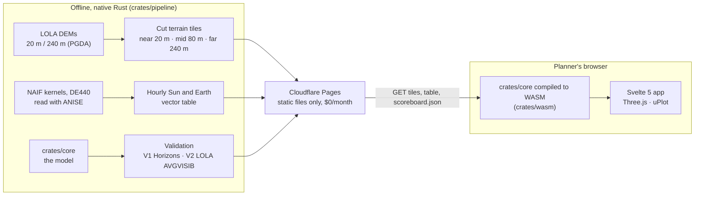

<p align="center">
  <picture>
    <source media="(prefers-color-scheme: dark)" srcset="design/brand/assets/wordmark.svg">
    <source media="(prefers-color-scheme: light)" srcset="design/brand/assets/wordmark-light.svg">
    
  </picture>
</p>

<p align="center">
  <a href="https://penumbra-lunar.pages.dev"><strong>penumbra-lunar.pages.dev</strong></a>
</p>

<p align="center">
  <a href="https://penumbra-lunar.pages.dev"></a>
  <a href="https://github.com/qicai14/penumbra/actions/workflows/ci.yml"></a>
  <a href="LICENSE"></a>
</p>

Penumbra tells a lunar landing planner how many hours of sunlight and Earth contact a lander gets at a south-pole site and date, and when the first lethal shadow arrives. One Rust model runs natively for validation and as WebAssembly in the browser, and it is checked against JPL Horizons and NASA LOLA illumination maps.

NASA Space Apps Challenge 2026 · Team **Fractured Toes**: Qi Cai and Charls.

## Who it is for

You plan a landing for a CLPS lander or an Artemis crew. You have a few candidate sites near the south pole and a few possible dates. At that latitude the Sun skims the horizon, so a distant ridge decides whether your solar panels charge and a crater rim can cut your line to Earth. For each site and date you need to know how long the lander will have power, how long it can talk home, and when the first shadow it cannot survive arrives.

Two recent landers show what happens when that goes wrong. Intuitive Machines' Odysseus (IM-1) landed on 2024-02-22 at 80.1276° S, 1.4367° E (E72a, E72b) on a 12° slope, came to rest about 30° off the surface, and ended "as the sun moved out of view of the one illuminated solar panel" ([SCIENCE-SPEC](docs/SCIENCE-SPEC.md) E75a–c). Athena (IM-2) reached Mons Mouton on 2025-03-06 and "ended up on its side within a 20-meter diameter crater" ([LROC](https://lroc.im-ldi.com/images/1408)); a low Sun angle and the panels' orientation stopped charging (E73, E74). NASA's Artemis III candidate list now holds nine south-pole regions ([NTRS 20250011660](https://ntrs.nasa.gov/citations/20250011660)), and Penumbra ships all nine plus the Shackleton ridge.

<p align="center">
  
</p>

## Three questions, one site and date

For a site, a landing date and a mast height, Penumbra answers:

| Question | What the app returns | Source |
|---|---|---|
| How many hours of sunlight? | Hours with any part of the Sun's disc above the real terrain horizon, from the 20 m LOLA DEM out to 7 km, 80 m to 31 km, 240 m beyond | [`docs/DATA-NOTES.md`](docs/DATA-NOTES.md) "Shipped tiles"; three-tier horizon in [`crates/core/src/horizon.rs`](crates/core/src/horizon.rs) (#48) |
| How many hours of Earth contact? | Hours with Earth above the horizon by a 2° margin (assumed: a preset value, taken from one paper's comms margin, not a mission requirement) | [`web/src/lib/engine.ts`](web/src/lib/engine.ts) preset `earth_margin_deg: 2`; SCIENCE-SPEC E62 |
| When does the first lethal shadow arrive? | The first moment stored battery energy falls to the preset's minimum (survival model) | [`docs/GLOSSARY.md`](docs/GLOSSARY.md) "Lethal shadow"; [`crates/core/src/power.rs`](crates/core/src/power.rs) (#10, T09) |

The app also gives the slope at the pin from the 20 m DEM (#112), the operable days for the next 30 landing dates (#108), side-by-side comparison of two site and date pairs, and a replay of the IM-2 site.

<p align="center">
  
</p>

| Landing window (Planner) | Compare A vs B |
|---|---|
|  |  |

## Penumbra beside the tools planners already use

Cells read yes, partial, no (server-based), or "not found in docs" where the tool's public docs were searched and nothing turned up. Lookups on 2026-11-15.

| Capability | Penumbra | NASA Moon Trek | LROC QuickMap | JPL Horizons |
|---|---|---|---|---|
| Sunlight hours at a site and date, terrain-shadowed | yes | partial: a "Surface Lighting" tool, no per-site sunlit-hours total [T1][T3] | partial: Terrain Shadows over a UTC range, no sunlit-hours total [Q1] | partial, no terrain: Sun rise and set from a site, against a horizon that allows dip "but not local topography" [H1] |
| Earth contact over time | yes | not found in docs (a Line of Sight tool exists) [T3] | partial: SUN+EARTH and EARTH shadow sources, no contact-hours output [Q1] | partial: rise and set of target bodies from a site [H1] |
| First lethal shadow | yes (#10) | not found in docs | not found in docs | not found in docs |
| 30-date landing window | yes, operable days for the next 30 landing dates (#108) | not found in docs | partial: start, end and delta-hours inputs, no sweep summary [Q1][Q3] | partial: raw start/stop/step tables only [H2] |
| Slope at a point | yes, from the 20 m DEM (#112) | partial: Slope tool, registered account needed [T1][T3] | partial: elevation at a point and along a path; slope not found in docs [Q2] | not offered (ephemeris service) |
| Validated against Horizons and LOLA | yes: V1 and V2 below | not found in docs [T2] | not found in docs | it is the reference: Horizons serves DE441 [H1] |
| Runs with no backend | yes: static files only | no (server-based) [T2] | no (server-based) [Q1] | no (server-based) [H1] |
| Cost | $0, no account | free to browse; lighting and slope need a registered account [T1] | price not found in docs; "Contact ACT" for Terrain Shadows [Q1] | free; "No account or password is required." [H1] |

Where the other tools are better:

- **Moon Trek** covers the whole Moon in one portal, with lighting, slope, Sun-angle and line-of-sight tools [T1][T3]. Penumbra covers ten south-pole regions.
- **QuickMap** carries the full LROC data catalogue, a Sun+Earth terrain-shadow tool over any time range, and CSV export [Q2]. Penumbra ships only the layers its model needs.
- **Horizons** is the ephemeris authority (DE441). It's free and scriptable through an API [H1][H2]. Penumbra's V1 test uses Horizons as its judge.

[SUNLOCK](https://github.com/nasa/spaceapps/discussions/2170) and [Lunar Window](https://github.com/nasa/spaceapps/discussions/2092) are other teams on this challenge; we did not compare features.

<sub>
[T1] https://trek.nasa.gov/moon/ ·
[T2] Moon Trek paper, https://moontrek.jpl.nasa.gov ·
[T3] https://meetingorganizer.copernicus.org/EGU23/EGU23-969.html ·
[Q1] https://qts.quickmap.io/fcgi-bin/fprovweb.exe?_xtype=text%2Fhtml&cmd_script=qts_js.msh ·
[Q2] https://docs.quickmap.io/toolbar/2-query (QuickMap lives at https://quickmap.lroc.im-ldi.com) ·
[Q3] https://docs.quickmap.io/map/0-time ·
[H1] https://ssd.jpl.nasa.gov/horizons/manual.html ·
[H2] https://ssd-api.jpl.nasa.gov/doc/horizons.html
</sub>

## How it works

There is no backend, and we run 0 servers. An offline Rust pipeline cuts NASA data into tiles and an ephemeris table, Cloudflare Pages serves them as static files, and the same Rust model, compiled to WebAssembly, runs in the planner's browser.



One model serves both sides ([ADR 0001](docs/adr/0001-one-rust-model-native-and-wasm.md)), so the scoreboard numbers and the planner's numbers come from the same code and cannot drift.

## Validation and measurements

### Validation scoreboard

From [`web/public/scoreboard.json`](web/public/scoreboard.json), read 2026-11-15. Misses are reported as misses.

| Test | Result | What it means |
|---|---|---|
| **V1**, JPL Horizons | pass, 0.00011° (threshold 0.002°, 20 samples) | Worst Sun or Earth azimuth/elevation difference over 20 site-time pairs, 2026–2030: 0.00011° (Earth); the Sun is 0.000013°. That is 18 times inside the threshold. |
| **V2**, LOLA AVGVISIB | pass, 0.48 points (threshold 5, 6 123 pixels) | Pooled median visibility error against NASA's 18.6-year average-visibility map; mean signed error +0.72, pooled Pearson r 0.955. Earth twin: median 0.18, r 0.990. Per-bin r is below 0.9 in every fifth (0.62 to 0.89); the pooled pass rests on the 0–60 % bins (#75). |
| **V2b**, published sites | fail (7 against threshold 6, 7 samples) | 7 of 7 Barker 2021 regions pass. It fails only because Mazarico 2011's SP-01 longest night, 2.75 days, lies 0.21 days below our shortest pixel (2.96 days). That gap is inside Mazarico's 6-hour step (about ±0.25 days), but the agreed rule is the strict range. |
| **V3**, LROC NAC images | not run | See Future work. |
| **V4**, IM-2 replay | pass | A reconstruction, not a validation: at the assumed touchdown the Sun stands 2.46° up, and a 1.94 m-deep pit hides it from panels at 0–1.44 m. |
| **V5**, red team | pass, 7 of 7 | All 7 edge cases pass (pole singularity, flat-pole bounds, 20 permanently shadowed sites that stay dark for 18.6 years). |

### Horizon computation time

One horizon is 720 azimuths marched over the near, middle and far tiles. The target is 50 ms ([ARCHITECTURE](docs/ARCHITECTURE.md) §2.2). On a quiet machine, native release ([`docs/DATA-NOTES.md`](docs/DATA-NOTES.md) U18): **median 17.20 ms** at IM-2 with a 2 m mast, **median 33.66 ms** at SP-01 with a 10 m mast.

Re-runs on 2026-11-15, on a shared, busy machine; they are load-dependent (Windows 11 Pro desktop, AMD Zen 2, 8 logical CPUs, 16 GB RAM):

| Where | IM-2, H = 2 m | SP-01, H = 10 m |
|---|---|---|
| Native, release (1 warm-up + 20 calls) | median 18.94 ms, max 23.87 ms | median 41.91 ms, max 51.02 ms |
| WASM in Bun 1.4.4 (single timed calls) | median 12.55 ms, max 14.97 ms | median 28.51 ms, max 36.61 ms |
| Browser, live app (Chromium 156, fresh profile, single timed calls) | median 18.15 ms, max 18.60 ms | median 34.25 ms, max 35.50 ms |

Every median in every run is under the 50 ms target. The single worst call in the re-runs, native SP-01 at 51.02 ms, was 1 ms over. Gaps of 5–10 ms between rows are run-to-run noise.

### Load, hosting and runtime calls

| Measure | Value | Source |
|---|---|---|
| First load (cold, transferred) | **34.3 MB**; the `.bin` tiles are 98 % of it. JS bundle 225 KB on the wire, WASM 52 KB | Resource Timing on https://penumbra-lunar.pages.dev/?cold=1, 2026-11-15 |
| Load event | 740 ms (data files keep arriving until about 2.9 s) | same |
| Hosting cost | **$0/month**: Cloudflare Pages, static assets only | "On both free and paid plans, requests to static assets are free and unlimited." [Cloudflare](https://developers.cloudflare.com/pages/functions/pricing/) |
| Servers we run | **0** | [`docs/STACK.md`](docs/STACK.md) Backend row: "none at runtime" |
| Runtime API calls | **0**: no API, no key, no database | network log of the cold load: every data and code request is a GET to `penumbra-lunar.pages.dev` |
| Third-party requests | **1 host family**: Google Fonts | measured on the cold load; the three font links in `web/index.html`. See Future work. |

## NASA data used

| Data | Used for | Citation |
|---|---|---|
| LOLA south-pole DEMs `LDEM_80S_20MPP_ADJ` (20 m), `LDEM_60S_240MPP_ADJ` (240 m), PSR mask `LPSR_80S_20MPP_ADJ` | Terrain horizon, slope, V5 shadowed sites | NASA GSFC PGDA, doi [10.60903/gsfcpgda-lola-spole](https://doi.org/10.60903/gsfcpgda-lola-spole), https://pgda.gsfc.nasa.gov/products/90; Barker et al. 2023 |
| PGDA illumination maps `AVGVISIB_85S_060M_201608` and `_EARTH` | V2 judge | https://pgda.gsfc.nasa.gov/products/69; 18.6 years hourly (W7) |
| NAIF kernels `de440.bsp`, `moon_pa_de440_200625.bpc`, `moon_fk_de440.epa`, `moon_de440_250416.tf` | Sun and Earth vectors in the Moon frame, via ANISE | https://naif.jpl.nasa.gov/pub/naif/generic_kernels/; DE440, Park et al. 2021 |
| JPL Horizons API | V1 judge | https://ssd-api.jpl.nasa.gov/doc/horizons.html |
| LROC | IM-2 landing site and crater (W6, W9); Artemis III region outlines via the QuickMap layer (W16) | https://lroc.im-ldi.com/images/1408; https://quickmap.lroc.im-ldi.com |
| Published PGDA-based studies | V2b reference values | Barker et al. 2021, Mazarico et al. 2011 |

Every number in this README comes from [`docs/submission/facts.md`](docs/submission/facts.md), which names its source. Evidence ids (C, E, W) resolve in [`docs/EVIDENCE.md`](docs/EVIDENCE.md) and [`docs/SCIENCE-SPEC.md`](docs/SCIENCE-SPEC.md); full reference entries are in [`docs/paper/refs.yml`](docs/paper/refs.yml).

## Stack, and why not the default

| Choice | Instead of | Why | Source |
|---|---|---|---|
| One Rust model, native and WASM | a Python or TS model plus a browser port | The scoreboard numbers and the planner's numbers come from the same code, so they cannot drift | [ADR 0001](docs/adr/0001-one-rust-model-native-and-wasm.md); [`docs/STACK.md`](docs/STACK.md) |
| ANISE (native only) + NAIF kernels | CSPICE, SpiceyPy | Pure-Rust SPICE reader with MOON_ME/MOON_PA frames; the kernels are 133 MB, so vectors ship as an hourly table of about 2.1 MB | [`docs/STACK.md`](docs/STACK.md); [ADR 0002](docs/adr/0002-ephemeris-table-on-a-utc-grid.md) |
| Svelte 5 + Vite | React / Next.js | Compiled, small bundle; one heavy canvas plus panels needs no React and no SSR | [`docs/STACK.md`](docs/STACK.md) |
| Plain Three.js, colours from the model | Threlte, GPU shadow maps | Shadow maps are unreliable at 1° Sun elevation; the picture must equal the validated numbers | [`docs/STACK.md`](docs/STACK.md); [ADR 0006](docs/adr/0006-illumination-from-the-model-not-shadow-maps.md) |
| uPlot | Chart.js, Plotly, ECharts | 260 k points per series stays smooth at about 50 KB | [`docs/STACK.md`](docs/STACK.md) |
| Bun + TypeScript | Python, npm | One non-Rust language; Bun runs TS directly | [`docs/STACK.md`](docs/STACK.md); [`AGENTS.md`](AGENTS.md) |
| Typst for the D1 paper | Word, Canva | Real equations, numbers pulled from repo files, plain text that diffs in PRs | [`docs/SUBMISSION.md`](docs/SUBMISSION.md) "Typst for D1" |
| Cloudflare Pages | Vercel, Netlify | Free, global, static; nothing to go down after judging | [`docs/STACK.md`](docs/STACK.md) Hosting and Backend rows |

## Who pays

Condensed from [`docs/submission/commercialization.md`](docs/submission/commercialization.md); every figure is a C-id in [`docs/EVIDENCE.md`](docs/EVIDENCE.md).

- **What failure costs.** CLPS task orders (as of Feb 2024): IM-1 $122.0 M, IM-2 $50.0 M, Astrobotic Griffin $322.8 M; the VIPER rover was $505.4 M (C1). CLPS is capped at $2.6 B through November 2028 (C3).
- **Buyers.** CLPS lander vendors choosing sites and dates; NASA and partner landing-site teams for the crewed south-pole landing; rover and ISRU teams sizing power and comms at a stop; universities teaching mission design.
- **Model.** Open core. The app and the Rust model stay free and Apache-2.0, so anyone can rerun V1 and V2. Paid work covers custom sites and dates, finer DEMs and a signed sign-off report.
- **Why now.** Artemis IV in 2028 (C4), Blue Moon MK1 in 2027 (C5), four more listed south-pole deliveries (C6), China's Chang'e-7 planned for the second half of 2026 (C7).

## Limitations and future work

| Limitation | Future work, with its path |
|---|---|
| Runtime data uses 94.2 of the 100 MB budget | #104: ten regions at 7.02 MB each plus the 21.78 MB far tile leave 5.8 MB. Before an eleventh region, state the rule in ARCHITECTURE §2.1: raise the budget, drop the mid tile where #48 allows, or shrink tiles. |
| The landing-window heatmap has only 3 grid dates (2025-03-06, 2026-05-31, 2026-11-14) | `web/public/data/manifest.json` `grids[].dates`; each grid costs 0.33 MB and about 3 minutes to build (#103 notes). Add dates with `penumbra-pipeline grid <data_dir> <region>` inside the #104 budget. The per-site 30-date window (#108) is computed live for any date. |
| V3 (LROC NAC shadow check) not run | `scoreboard.json` V3 `notes: "not run"`. Steps in SCIENCE-SPEC "V3 details": read START_TIME from each NAC's PDS label, threshold the NAC and NASA's `_MODEL.TIF` with Otsu, compare IoU; pass if within 0.05 of NASA's own model. |
| Sites work only inside the ten shipped tiles | #103: a design note sizing on-demand tiles, a tile server, or a coarser any-site mode with its error stated. Building a tile takes seconds; shipping it is the limit. |
| First load is 34.3 MB | The `.bin` tiles are served uncompressed (encoded = decoded on the cold load). Check Brotli on `.bin` at Cloudflare (STACK "compression unverified"), and lazy-load the 21.78 MB far tile and the ten grids until a site is picked. |
| Region outlines come from QuickMap's file host | #106: compare the USGS grids (doi 10.5066/P1MEQ6UK) with W16 and record the result as a ledger row. |
| Fonts load from Google, so the app is not single-origin | Self-host IBM Plex Mono and Archivo as woff2 under `web/public/` and drop the three font links in `web/index.html`. |
| The WASM timing bench is not in the repo | Commit it as `scripts/bench-horizon.ts` so the WASM row can be re-run with one `bun` command. |

## Run it

Rust stable with the `wasm32-unknown-unknown` target, the `wasm-bindgen` CLI and Bun. `scripts/bootstrap.sh` checks and installs what it can.

```bash
bash scripts/bootstrap.sh
bun install
bun run dev        # builds the WASM engine, then starts the Vite dev server
bun run test       # Rust tests (cargo test --workspace)
bun run --cwd web test   # web unit tests, including the grid-vs-engine equality check
bun run paper      # project document, docs/paper/penumbra.pdf (needs typst)
```

The terrain and ephemeris files the app needs are already in `web/public/data`. Rebuilding them needs the raw NASA data and the native pipeline (`crates/pipeline`); see [`docs/STACK.md`](docs/STACK.md).

### Layout

- `crates/core`: the model (horizon, ephemeris, visibility, survival). Pure maths, no I/O. Its tests are in `crates/core/tests` (for example `horizon.rs` and `survival.rs`).
- `crates/pipeline`: native, offline tools that cut the data and run the validation.
- `crates/wasm`: browser bindings to the same `core`.
- `web/`: Svelte 5 app (Three.js, uPlot).
- `docs/`: science spec, evidence and the project document.

## Credits

- ANISE and Nyx Space, for a pure-Rust SPICE reader that kept the ephemeris pipeline in one language ([nyx-space/anise](https://github.com/nyx-space/anise)).
- NASA: the LOLA team and GSFC PGDA, LROC, NAIF and JPL Solar System Dynamics. Every number in Penumbra starts from their open data and services.
- The NSAKL26 organisers, for running NASA Space Apps Challenge 2026.
- The open-source libraries we build on: Rust and wasm-bindgen, Svelte, Vite, Three.js, uPlot, Bun, Playwright and Typst, and the IBM Plex Mono and Archivo typefaces.

Team **Fractured Toes**: Qi Cai and Charls.

## References

- Mazarico et al. 2011, Illumination conditions of the lunar polar regions using LOLA topography, *Icarus*. https://ntrs.nasa.gov/citations/20120010094
- Barker et al. 2021, Improved LOLA elevation maps for south pole landing sites: error estimates and their impact on illumination conditions, *Planetary and Space Science*. https://ntrs.nasa.gov/citations/20205009660
- Barker et al. 2023, A New View of the Lunar South Pole from the Lunar Orbiter Laser Altimeter (LOLA), *The Planetary Science Journal*. doi [10.3847/PSJ/acf3e1](https://doi.org/10.3847/PSJ/acf3e1)
- Park et al. 2021, The JPL Planetary and Lunar Ephemerides DE440 and DE441, *The Astronomical Journal*. doi [10.3847/1538-3881/abd414](https://doi.org/10.3847/1538-3881/abd414)
- De Rosa 2012, Characterisation of potential landing sites for the European Space Agency's Lunar Lander project, *Planetary and Space Science*. https://arxiv.org/abs/1208.5587
- Gläser et al. 2018, Illumination conditions at the lunar poles: implications for future exploration, *Planetary and Space Science*. https://ntrs.nasa.gov/citations/20170007365

Full entries: [`docs/paper/refs.yml`](docs/paper/refs.yml).

## License

Apache-2.0, see [`LICENSE`](LICENSE).
