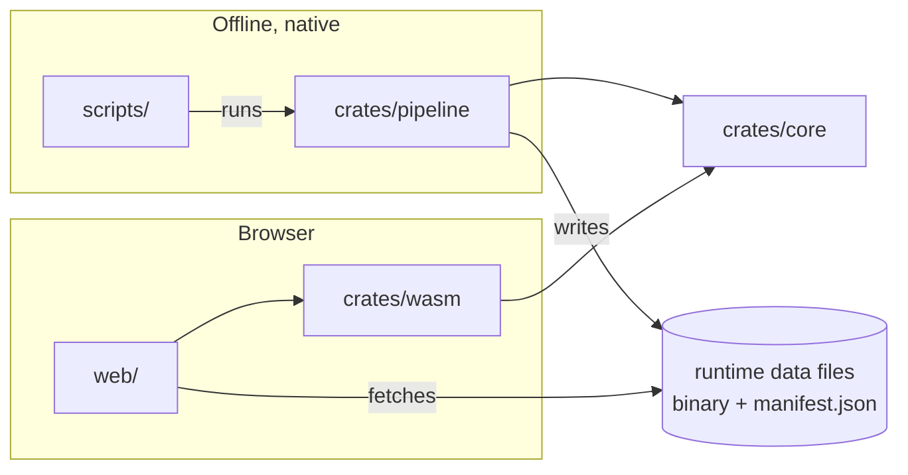
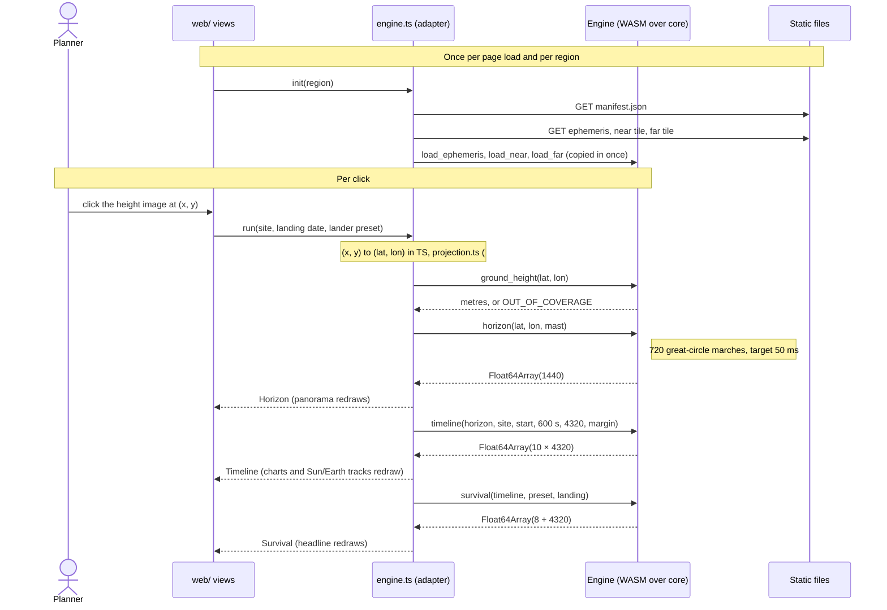

# Architecture — Penumbra

**Progress:** COMPLETE (Nov 11). §1–§6 written; ADRs 0001–0006 in `docs/adr/`, accepted by Qi Cai on Nov 12.

Review of the architecture, data structures and stack before the 39-hour build (Nov 14–15). Written Nov 11 against branch `scaffold` (PR #1). Documents only: nothing here has been run. Every number that isn't taken from a repo document or derived by arithmetic shown here is marked **[est]**. There are no benchmarks in this file, only budgets.

## 1. System architecture

### 1.1 Module map

| Module | Single responsibility | Runs | May depend on |
|---|---|---|---|
| `crates/core` (`penumbra-core`) | The science model as pure functions over slices: projection, DEM sampling, horizon, ephemeris interpolation, illumination, timeline, survival. No I/O, no clock, no threads, no `std::fs`. | native and wasm32 | nothing (std only) |
| `crates/pipeline` (`penumbra-pipeline`) | Turn NASA source files into the runtime data files, and run validation. Owns ANISE, `tiff`, file I/O and the Horizons fixtures. | native only, offline | `core`, ANISE, `tiff` |
| `crates/wasm` (`penumbra-wasm`) | The browser's view of `core`: holds loaded data, converts between JS typed arrays and core slices, and nothing else. No maths. | browser (wasm32) | `core`, `wasm-bindgen` |
| `web/` | Everything the user sees: fetch data files, call the engine, draw the terrain, panorama, timelines and headline. No science: it never computes an angle. | browser | generated `web/src/lib/wasm/`, Three.js, uPlot |
| `scripts/` | Repo tooling in Bun TypeScript: bootstrap, plugin checks, and (from Nov 14) the scoreboard assembly and data upload. No model logic. | native, offline | Bun only |

### 1.2 Dependency direction



Rules that keep this true:

1. `core` has no dependencies and no `cfg(target_arch)` branches. If a function needs a file, the caller passes the bytes.
2. `pipeline` and `wasm` never depend on each other. They meet only through `core` types and the data file formats.
3. `web/` imports the engine from one file (`web/src/lib/engine.ts`, to be created), never from `lib/wasm/` directly. That file is the seam where the fixture engine and the real engine swap (§3).
4. The data files have no headers. Their shapes and scales live in `manifest.json` (§3.5). The structs that describe a tile and an ephemeris segment are defined once in `core`; `pipeline` fills the manifest from them and `wasm` rebuilds them from the manifest values, so the two can't drift.
5. State lives in one place: the files loaded into the engine. Every result is a pure function of the loaded files and the call's arguments. Nothing is cached inside WASM between calls.

### 1.3 What runs where

| Step | Module | Runs | Output |
|---|---|---|---|
| Download DEM, kernels, PGDA maps | `scripts/` (curl with resume) | offline, once, Sat 09:03 | `data/` (gitignored) |
| Ephemeris table from ANISE + hifitime | `pipeline` | offline, once per segment | f64 table, 2.10 MB (§2.4) |
| Crop the DEM and encode int16 tiles | `pipeline` | offline, once per region | near tile 4.72 MB each, far tile 20.28 MB (§2.1) |
| Heatmap grids (Should) | `pipeline` | offline, per region | u16 grids, about 46 kB per layer (§2.6) |
| Tests that need no data (T-1a…T-1e, V1 fixtures, most of V5) | `cargo test` on `core` | offline and CI | pass or fail |
| Checks that need `data/` (T-1a-4, T-1a-5, V5 case 3, A1, V2) | `pipeline --release` | offline only | `scoreboard.json` |
| Fetch manifest and data files | `web/` | browser, per page load and region | bytes |
| Ground height, horizon, Sun and Earth track, timeline, survival | `wasm` → `core` | browser, per scenario change | typed arrays |
| Panorama, timelines, headline, map | `web/` | browser | pixels |

The same `core::horizon` and `core::timeline` run in the pipeline (heatmaps, V2, V5) and in the browser. That is the point of the design, and the reason `core` must stay free of I/O.

### 1.4 Sequence: click a point → horizon → timelines → survival headline



What reruns on each kind of change (the adapter keeps the last horizon, keyed by lat, lon and mast height):

| Change | horizon | timeline | survival |
|---|---|---|---|
| Site or mast height | yes | yes | yes |
| Landing date or span | no | yes | yes |
| Earth margin | no | yes | yes |
| Any other lander preset field | no | no | yes |

## 2. Data structures and algorithms

Sizes used throughout: R = 1 737 400 m; 720 azimuths at 0.5° (SCIENCE-SPEC §1a); near field 20 m to 7 km, far field 240 m beyond; far tile ±382 km; hourly ephemeris 2026–2030; timelines at 10 min. 360 azimuths halves every horizon number below, but the spec fixes 720 and the Sun's disc (0.53°) is about one 0.5° bin wide, so 360 would undersample it.

### 2.1 DEM tiles

**Layout.** A tile is a flat row-major `i16` array plus eight numbers from the manifest: `width`, `height`, `x0_m`, `y0_m` (upper-left corner), `pixel_m`, `scale_m`, `offset_m`, `nodata`. Row 0 is the largest y. Pixel-is-area (U5, to confirm from the GeoTIFF tags in T06).

| Tile | Pixels | Bytes | Covers | Scale |
|---|---|---|---|---|
| Source `LDEM_80S_20MPP_ADJ` (never loaded whole) | 30 400² | 3.70 GB decoded | ±304 km | float |
| Near, one per region | 1536² = 2 359 296 | 4 718 592 (4.72 MB) | 30.72 km square at 20 m | 0.25 m or finer |
| Far, shared | 3184² = 10 137 856 | 20 275 712 (20.28 MB) | ±382.08 km at 240 m | 0.5 m |

- Runtime download: two regions 2 × 4.72 + 20.28 + 2.10 = 31.8 MB; nine regions 64.9 MB. Both are inside the 100 MB budget.
- Browser memory, steady state: the engine holds one near tile, the far tile and the ephemeris, 27.1 MB. `web/` keeps its own copy of the near tile to draw the height image, 4.7 MB. While a file loads, its fetch buffer and its WASM copy exist together, so the peak is about 20 MB higher for a moment.
- The pickable area of a near tile is the tile minus a 7.05 km border (7 km of ground, map length scale): 16.62 km square.

**Height decode.** `h = offset_m + scale_m × v`, with `v == nodata` an error (never 0 m, P5).
- Near scale: the encoder picks the finest of 0.0625, 0.125, 0.25 m that fits the tile's height range in ±32 767 counts, and fails if 0.25 m clips. At 0.25 m the quantisation error is 0.072 m RMS (spec); at 0.125 m it is 0.036 m. A 30 km tile whose relief is under 8.19 km gets 0.125 m for free, and the decoder doesn't change because the scale comes from the manifest.
- Far scale 0.5 m: int16 at 0.25 m spans only ±8 191 m, which the far field may exceed (review F2 note). At 7 km or more a 0.25 m error is at most 0.002°.
- Why int16 and not f32: f32 doubles every size (two regions 61 MB, nine regions 127 MB, over budget) and doubles the cache footprint of the march.

**Indexing.** For a map point (x, y) in metres:

```
fc = (x − x0_m) / pixel_m − 0.5        i = floor(fc)   a = fc − i
fr = (y0_m − y) / pixel_m − 0.5        j = floor(fr)   b = fr − j
valid only if 0 ≤ i < width − 1 and 0 ≤ j < height − 1, else OUT_OF_COVERAGE
v = bilinear(v[j·width + i], v[j·width + i + 1], v[(j+1)·width + i], v[(j+1)·width + i + 1]; a, b)
```

Interpolate the raw counts, then scale once. Four loads from two rows, about 10 flops.

**Polar-stereographic transform** (SCIENCE-SPEC §1a, re-derived in the review). Both directions are trig-free, which matters because the forward one runs inside the march:

```
inverse (map → unit vector, once per site):   t = (x² + y²) / (4R²)
                                              û = ( y/R , x/R , −(1 − t) ) / (1 + t)
forward (unit vector → map, once per sample): x = 2R · u_y / (1 − u_z)
                                              y = 2R · u_x / (1 − u_z)
```

- Forward costs one division and two multiplications. Near the south pole `1 − u_z ≈ 2`, so it is well conditioned.
- Longitude 0 is along +y, 90°E along +x. The orientation is pinned by tests, not by trust: SP-01 → (−11.31, −12.26) km and the IM-2 site → (+77.1, +138.0) km (F20).
- Map scale is k = 1 + t: 1.0021 at the IM-2 site, 1.0121 at the far tile's edge. Distances are measured on the sphere (the march steps in great-circle angle), so k only matters for the coverage check, which is done in map coordinates.
- f64 only (N7). f32 at 1.7 × 10⁶ m resolves 0.125 m, which is a 0.36° error across one 20 m pixel.

### 2.2 Horizon ray-march

**Algorithm.** For each of 720 azimuths, walk outward along the great circle and keep the largest elevation and the distance where it occurred.

```
setup, once per site:
  û_s from (x_s, y_s);  up = û_s;  east = ẑ × û_s normalised (at the pole: north = +X, east = +Y);  north = û_s × east
  r_o = R + h(x_s, y_s) + H
setup, once per process (the step table, shared by every azimuth and every site):
  s_j, sinθ_j, versθ_j   with θ_j = s_j / R and versθ = 1 − cosθ = 2·sin²(θ/2)
per azimuth i (az = i × 0.5°):
  d̂ = north·cos(az) + east·sin(az)
  per step j:
    û = û_s·(1 − versθ_j) + d̂·sinθ_j              9 flops
    (x, y) = forward(û)                             1 division, 2 mul
    h = sample(tile, x, y)                          4 loads, ~14 flops
    r_t = R + h
    num = (r_t − r_o) − r_t·versθ_j                 = r_t·cosθ − r_o, without cancellation
    den = r_t·sinθ_j
    if num·best_den > best_num·den: keep (num, den, s_j)     tan(el) compared by cross-multiplying
  el_hor[i] = atan2(best_num, best_den);  dist[i] = best s_j
```

No trig and no square root inside the inner loop: about 45 flops, 1 division, 4 loads and 4 branches per sample. The elevation uses the exact form `tan(el) = (r_t·cosθ − r_o)/(r_t·sinθ)`; the small-angle form is 0.0006° off in the spec's own test vector and must not be used.

**Step schedule.** One pixel of the tier in use (spec):

| Tier | Steps | Count |
|---|---|---|
| Near, 20 m tile | s = 20 m × j, j = 1…350 (the site's own pixel is skipped) | 350 |
| Far, 240 m tile | s = 7 000 m + 240 m × j, until the early exit or the tile edge | 804 to 200 km; at most 1 562 to the edge at 382 km |

The step table is at most 1 912 entries × 3 f64 = 46 kB. The switch at exactly 7 km is deliberate: every site is at least 7 km inside its near tile, so the near march can never leave coverage. T-1a-4 decides whether 7 km is enough.

**Curvature term.** It is the `r_t·versθ` part of `num`. The drop below the tangent plane is s²/2R: 0.74 m at 1.6 km, 720 m at 50 km, 6.5 km at 150 km, 11.5 km at 200 km. That last number is why the march can stop: beyond roughly 200 km nothing on the Moon's south polar terrain stands high enough to matter (F2: a 7 km peak at 200 km sits at −1.30°).

**Early exit** (review F1). With `r_max = R + h_max` (h_max is the largest height in the far tile, found once at load):

```
bound_j = ((r_max − r_o) − r_max·versθ_j) / (r_max·sinθ_j)       4 flops, reuses the step table
stop this azimuth when bound_j < best tan(el), provided r_max > r_o
```

The bound falls monotonically when r_max > r_o (its derivative has the sign of r_o·cosθ − r_max), so stopping is safe. When the site stands above everything (r_max ≤ r_o) the bound rises until cosθ = r_max/r_o, which is at s = √(2Rδ) for a site δ above h_max (5.9 km for δ = 10 m); the exit may be re-enabled past that distance, or left off as the spec says. Test N11 covers it either way.

Where the exit fires for a horizon near 0°, with Δ = h_max − h_s − H: s = √(2RΔ), so 144 km for Δ = 6 km and 177 km for Δ = 9 km. For a ridge site looking down at −1.5° with Δ = 5 km it is 185 km. The exit therefore saves the stretch from about 150–190 km to the tile edge, not more. It is a guard against the 382 km worst case, not a speed-up of the typical case.

**Flat arrays or a max-pyramid?** Flat arrays.

| | Flat tiles + fixed steps + h_max exit | Max-mipmap / quadtree over the far tile |
|---|---|---|
| Extra memory | 0 | +1/3 of the far tile, 6.8 MB |
| Samples per horizon | 0.68–1.38 M (below) | fewer where the near horizon is high (crater floors); little saved on ridges, where the horizon is near 0° and most distant cells stay candidates |
| Code | one loop, about 60 lines [est] | hierarchical traversal with a curvature-aware bound per node, about 150 lines plus its own tests [est] |
| Correctness risk | low: T-1a-1 and T-1a-3 pin it | a wrong bound hides peaks silently |
| Bias | point samples along the ray | max over a cell raises the horizon, which biases V2 dark |

The pyramid buys speed the budget doesn't need (arithmetic below) at the price of the one failure mode that tests don't catch. If the Saturday benchmark fails, the ladder is in "If it misses".

**The 50 ms budget, in arithmetic.**

| Case | Samples per azimuth | × 720 | Budget per sample at 50 ms |
|---|---|---|---|
| A. Exit at 150 km | 350 + 596 = 946 | 681 000 | 73 ns |
| B. March to 200 km | 350 + 804 = 1 154 | 831 000 | 60 ns |
| C. No exit, tile edge at 382 km | 350 + 1 562 = 1 912 | 1 377 000 | 36 ns |

- Work per sample is about 45 flops and one division. SCIENCE-SPEC's own unmeasured figure (U18) is 0.5 M lookups in 5–10 ms native, which is 10–20 ns per sample. WASM typically runs such scalar f64 loops at 1.5–2× native **[est]**, giving 15–40 ns **[est]**.
- At 15–40 ns: case A 10–27 ms, case B 12–33 ms, case C 21–55 ms **[est]**. Cases A and B fit. Case C fits only at the fast end, which is why the exit rule matters.
- Memory is the part arithmetic can't settle. The near march touches a 7 km disc: π × 350² px × 2 B = 0.77 MB. The far march touches a 200 km disc: π × 833² px × 2 B = 4.36 MB of the 20.28 MB tile. Beyond 27 km the rays are more than one pixel apart, so each far sample there lands on a cache line no other ray has loaded, and a row is 6 368 bytes, longer than a 4 kB page, so the hardware prefetcher may not follow rays that cross rows. Worst case is about 0.5 M cache misses. The sample addresses don't depend on loaded data, so the CPU can overlap those misses; whether that costs 5 ms or 40 ms **[est]** is the thing the benchmark measures.
- Fixed costs are negligible: 720 sin/cos pairs, 720 `atan2`, one 46 kB table.

So the target is plausible at 720 azimuths with no pyramid, and unproven. It is risk 1 in §5.

**If it misses.** In order, stopping at the first that works:
1. Build `core` at `opt-level = 3`. The scaffold sets `opt-level = "s"` for the whole workspace, which trades loop speed for size (§4).
2. A coarse skip grid: the max of each 16 × 16 px block of the far tile (199² × 2 B = 79 kB, fits in L2). Before marching the next 16 far steps, test the blocks they cross against the current best; skip the steps if none can beat it. About 40 lines [est], and it never changes a result.
3. Accept up to 200 ms behind a worker (§3.4). A click still feels immediate; only pin-dragging suffers.
4. Above 2 s (PLAN-DRAFT gate G2): slip cut 3, horizons precomputed on a 100 m grid.

### 2.3 Horizon profile and Sun-disc fraction

**Profile.** Inside `core`: `el: [f64; 720]` in radians and `dist: [f64; 720]` in metres, 11 520 bytes. Index i is azimuth i × 0.5°, clockwise from north. At the API edge it is one `Float64Array(1440)` in degrees and metres (§3). The "obstacle closer than 3 pixels" flag (P13) is `dist < 60`, so it is derived by the reader, not stored.

Lookup at any azimuth is a linear interpolation between two bins with wrap-around at 720 (N8): 2 loads and about 6 flops. Linear interpolation is what the references use (E05).

Stored form, used only by slip cut 3: int16 at 0.002° per count (±65.5°, error ≤ 0.001°), 720 per grid point, 1 440 bytes. One grid is for one mast height.

**Sun-disc fraction** (SCIENCE-SPEC §1b with fix F18). No lookup table of fractions is needed; the only table is 32 constants.

```
constants: x_i = −1 + (2i + 1)/32,  c_i = sqrt(1 − x_i²),  i = 0…31        256 bytes, shared
per step:  ρ = asin(R_sun / d_sun)
           quick test over the 3 horizon bins the disc can touch (its half-width in azimuth is at most 0.28°):
             el_sun − ρ ≥ max of those bins → f = 1
             el_sun + ρ ≤ min of those bins → f = 0
           otherwise: w_i = ρ·c_i;  g_i = el_hor(az_sun + ρ·x_i / cos el_sun) − el_sun
                      f = Σ clamp(w_i − g_i, 0, 2w_i) / Σ 2w_i
```

- The quick test is exact, because an interpolated horizon never leaves the range of its end points. It makes f exactly 1 for a clear disc and exactly 0 for a hidden one (N2, T-1b-2).
- The full sum is 32 horizon lookups and about 400 flops. It runs only while the Sun is within ρ of the horizon.
- **Illumination** is f. **Visibility** is f > 0. They are separate outputs with those names (P1).
- The closed form `(acos u − u·sqrt(1 − u²))/π` is for a flat horizon only. It is the test oracle (T-1b-1, tolerance 2e-3 with 32 strips), not the implementation.

### 2.4 Ephemeris table

**Layout.** One segment is a flat `f64` array, row-major, 6 per row: Sun x, y, z then Earth x, y, z, in km, Moon-centred, apparent (light time and stellar aberration), MOON_ME.

| Segment | Rows | Bytes |
|---|---|---|
| Main: 2026-01-01T00:00:00Z to 2031-01-01T00:00:00Z, hourly | 1 826 days × 24 + 1 = 43 825 | 2 103 600 (2.10 MB) |
| IM-2 replay, about 45 days around 2025-03-06 | 1 081 | 51 888 |

SCIENCE-SPEC says 43 830 rows; 43 825 is the exact count. The engine holds a short list of segments (`t0`, `step`, rows) and picks the one that contains the time; three or fewer, so a linear scan.

**Lookup and interpolation.**

```
u = (t_unix_s − t0) / 3600;  k = floor(u);  a = u − k
valid only if 0 ≤ k ≤ rows − 2 (or k = rows − 1 with a = 0), else OUT_OF_TABLE (P16)
r = (1 − a)·row[k] + a·row[k + 1]            12 flops, two adjacent 48-byte rows
```

Linear is enough: the direction error is about 0.0001° (review F4), twenty times inside the 0.002° V1 target, and T-1c-1 gates it at 0.001° over 1 000 random instants. Six consecutive 10-minute steps share the same two rows.

**UTC handling (review F3).** Rows sit on whole UTC hours and are built natively with hifitime; the browser never converts a time scale. A table on a TDB grid read as UTC would be 69.184 s off, which is 0.0098° of Sun azimuth, five times the V1 target, and it would pass native tests and fail only in the app.

- Every time that crosses a module boundary is **Unix seconds, UTC, as f64**. `main` starts at t0 = 1 767 225 600. f64 holds this to well under a microsecond. JS gets it from `Date.getTime() / 1000`, and uPlot's time axis takes Unix seconds directly.
- Leap seconds (U12): Unix time has none, and neither does a table indexed by whole UTC hours, so the index arithmetic stays exact even if one were inserted during 2026–2030. Only interpolation inside that one hour would be off by up to 1 s, which is 0.00014°.
- V1 must run through this path (table plus interpolation), not through ANISE directly (N3).

**From vectors to az/el, per step and per body.** `d = r − s` with the site vector `s = (R + h + H)·û_s` in km; `el = asin(d·up / |d|)`; `az = atan2(d·east, d·north)`; `ρ = asin(R_body / |d|)`. That is one square root and three inverse-trig calls per body. The subtraction is the parallax correction (0.26° for Earth), so it can't be skipped.

### 2.5 Timeline and survival

**Timeline.** n steps, 10 columns, f64, stored column by column (§3.2).

| Request | Steps | Output bytes | Time **[est]** at 0.1–0.4 µs per step |
|---|---|---|---|
| 30 days at 10 min (T12) | 4 320 | 345 600 | 0.4–1.7 ms |
| 5 years at 1 h | 43 825 | 3.5 MB | 4–18 ms |
| 5 years at 10 min | 262 945 | 21.0 MB | 26–105 ms |

Per step: one table interpolation, two bodies to az/el (6 inverse-trig calls, 2 square roots), two horizon lookups, the disc fraction, and the Earth margin `el_earth − el_hor(az_earth)`. The per-step estimate is dominated by the inverse-trig calls, which in WASM are software routines; it is not measured. Must only needs the first row of the table. The 5-year 10-minute series is the only one that needs care, and nothing in Must asks for it.

**Sums.** SCIENCE-SPEC doesn't say how hours are added up. Proposed, for the Hour 0 freeze: every total is a count of steps times Δt, with
- sunlit hours = Σ illumination × Δt (so a half-hidden Sun counts half),
- contact hours = Σ contact × Δt,
- operable hours = Σ (illumination > 0 and contact) × Δt, matching the glossary's operable window,
- longest darkness = the longest run with illumination = 0.

**State of charge** (SCIENCE-SPEC §1e with fix F7). Per step:

```
S     = 1366.1 · (1 AU / d_sun)²                        W/m²
P_gen = S · A · η · max(0, n̂·ŝ) · f                     W      (n̂·ŝ = 1 when Sun-tracking)
E*    = E_k + (P_gen − P_load) · Δt                     Wh, Δt in hours
if E* ≤ E_min:  lethal time = t_k + Δt · (E_k − E_min) / (E_k − E*);  stop
E_{k+1} = min(E*, E_max)
```

About 15 flops per step, so 4 320 steps cost tens of microseconds [est]. The series is n f64 (34.6 kB for 30 days). After the lethal shadow the series holds E_min to the end, so the chart shows a flat dead battery and no NaN reaches uPlot. The lethal time is taken from E* before clamping, as F7 requires; T-1e-1 (7.050 h ± 1e-9) fails otherwise.

### 2.6 Heatmap precompute: stored versus derived

SCIENCE-SPEC's rule is "do not store horizons for heatmaps; store the derived numbers". The arithmetic agrees.

| Option, for one 15 × 15 km region at 100 m (151² = 22 801 points) | Stored | Any date and preset in the browser? |
|---|---|---|
| Horizons, 720 × int16 per point | 32.8 MB per region, 295 MB for nine | yes, at 1 440 bytes and one timeline per point: 22 801 × 4 320 steps is 10–40 s [est] at 10 min |
| **Derived numbers per landing date and preset** | 22 801 × u16 = 45.6 kB per layer | no: only the dates and preset that were baked |

- **Stored:** for each baked landing date, one `u16` grid per metric, in hours: operable hours and time to first lethal shadow. Two sentinels: 65 535 = no data, 65 534 = no lethal shadow in the span. Twelve dates × two metrics is 1.1 MB per region. The manifest lists the grid origin, spacing, dates, preset and metric names.
- **Derived in the browser:** the colours, the ranking, and anything about one cell in detail. Clicking a cell runs the live engine for that site, and T24's acceptance check (five random cells equal the live result) holds the two paths together.
- **Offline cost:** 22 801 horizons at the spec's unmeasured 10–20 ms each is 4–8 core-minutes, plus the timelines. No thread pool is needed for one region.
- Slip cut 3 is the exception that does store horizons: 101² points × 1 440 B = 14.7 MB per 10 × 10 km, for one mast height. The engine API doesn't change in that case; `horizon` reads the nearest stored profile and the pin snaps to the grid.

One number in PLAN-DRAFT fails this arithmetic. T21 (overflow) asks for a 256 × 256 shadow mask in under 1 s: 65 536 rays × 1 154 samples is 75.6 M samples, 1.1–3 s at 15–40 ns [est]. Marching only the near tile (350 samples, 22.9 M) fits; the far field would have to come from one horizon at the tile centre. Decide when T21 is pulled, not before.

### 2.7 Cost summary

| Structure | Memory | Time per use |
|---|---|---|
| Near tile | 4.72 MB | 252 000 samples per horizon |
| Far tile | 20.28 MB (4.36 MB touched per horizon) | 429 000–1 125 000 samples per horizon |
| Step table | 46 kB | built once |
| Horizon profile | 11.5 kB | 12–33 ms typical, 55 ms worst **[est]**; target 50 ms |
| Disc constants | 256 B | up to 32 lookups per step, only near the horizon |
| Ephemeris, main | 2.10 MB | 12 flops per step |
| Timeline, 30 days at 10 min | 346 kB | 0.4–1.7 ms **[est]** |
| Survival series | 34.6 kB | tens of µs **[est]** |
| Heatmap layer | 45.6 kB | drawn directly |

## 3. The WASM boundary

PLAN-DRAFT §1 already proposes the function names and units for the Hour 0 freeze. This section keeps those names and changes four things, each for a stated reason:

| PLAN-DRAFT proposal | Change | Why |
|---|---|---|
| `horizon` takes "near tile + metadata, far tile + metadata" on every call | The tiles are loaded once into a stateful `Engine` | wasm-bindgen copies every slice argument into WASM memory. Passing the tiles per call copies 25 MB per click. |
| Results are "rows × N f64" (row-major) | Results are column-major: all of column 0, then all of column 1 | uPlot takes one array per series. `subarray` then gives each column as a view with no copy and no loop. |
| `sun_earth_track` returns 8 columns with no time | Time is column 0 of every series result | One x array for every chart, and no way to pair a series with the wrong times. |
| `horizon` returns a "closer than 3 pixels" flag | Dropped; the reader tests `dist_m < 60` | It is derivable, and a flag is one more array to keep in step. |

It also adds `ground_height`, which the plan needs but doesn't name. It first added `xy_to_latlon` and `latlon_to_xy` too; #58 dropped them, and `web/src/lib/projection.ts` projects in TS, cross-checked against `core::geometry` to 1 mm.

### 3.1 Conventions (frozen with the API)

- **Angles** are degrees at the boundary and radians inside `core`. **Azimuth** is clockwise from north, 0 ≤ az < 360. **Longitude** is east-positive; outputs are in [0, 360), inputs accept any value.
- **Time** is Unix seconds UTC, f64. **Lengths** are metres, except ephemeris distances in km. **Energy** is Wh, power W.
- **Heights**: `ground_m` is metres above the 1 737 400 m sphere; `mast_m` is the mast height H above the ground.
- Every number crossing the boundary is f64. There is no f32 anywhere in the API (N7).
- **Errors** are thrown as a JS `Error` whose message starts with a code and a colon: `NOT_LOADED`, `OUT_OF_COVERAGE`, `NO_DATA`, `OUT_OF_TABLE`, `BAD_INPUT`. A function never returns a default in place of an error (P5, P16).
- `api_version()` returns 4 (see API.md for the history). The fixture and the manifest carry the same number; the adapter refuses a mismatch.

### 3.2 The API to freeze at Hour 0

Canonical copy since T00: [docs/API.md](API.md). Change it there first, under its change rule, and mirror it here.

Rust signatures in `crates/wasm`. wasm-bindgen generates the `.d.ts` from them.

```rust
#[wasm_bindgen] pub fn api_version() -> u32;                                   // 4

#[wasm_bindgen] pub struct Engine { /* ephemeris segments, near tile, mid tile, far tile */ }

#[wasm_bindgen]
impl Engine {
    #[wasm_bindgen(constructor)]
    pub fn new() -> Engine;

    // Loading. Each call copies the array into the engine once; the engine owns it from then on.
    pub fn load_ephemeris(&mut self, t0_unix_s: f64, step_s: f64, data: Box<[f64]>) -> Result<(), JsError>;
    pub fn load_near(&mut self, data: Box<[i16]>, width: u32, height: u32, x0_m: f64, y0_m: f64,
                     pixel_m: f64, scale_m: f64, offset_m: f64, nodata: i16) -> Result<(), JsError>;
    pub fn load_mid(&mut self, data: Box<[i16]>, width: u32, height: u32, x0_m: f64, y0_m: f64,
                    pixel_m: f64, scale_m: f64, offset_m: f64, nodata: i16) -> Result<(), JsError>;
    pub fn load_far(&mut self, data: Box<[i16]>, width: u32, height: u32, x0_m: f64, y0_m: f64,
                    pixel_m: f64, scale_m: f64, offset_m: f64, nodata: i16) -> Result<(), JsError>;

    // Model. Arguments are scalars or small arrays; results are new arrays owned by JS.
    pub fn ground_height(&self, lat_deg: f64, lon_deg: f64) -> Result<f64, JsError>;
    pub fn sun_earth_track(&self, lat_deg: f64, lon_deg: f64, ground_m: f64, mast_m: f64,
                           start_unix_s: f64, step_s: f64, count: u32) -> Result<Vec<f64>, JsError>;
    pub fn horizon(&self, lat_deg: f64, lon_deg: f64, mast_m: f64) -> Result<Vec<f64>, JsError>;
    pub fn timeline(&self, horizon: &[f64], lat_deg: f64, lon_deg: f64, ground_m: f64, mast_m: f64,
                    start_unix_s: f64, step_s: f64, count: u32, earth_margin_deg: f64)
                    -> Result<Vec<f64>, JsError>;
}

#[wasm_bindgen] pub fn survival(timeline: &[f64], preset: &[f64], landing_unix_s: f64)
                    -> Result<Vec<f64>, JsError>;

// Should tier. Names frozen now; built in T15 and T17.
#[wasm_bindgen] pub fn pit_horizon(horizon: &[f64], pit_diameter_m: f64, pit_depth_m: f64,
                                   panel_height_m: f64) -> Vec<f64>;            // same layout as horizon
#[wasm_bindgen] pub fn pit_depth_to_hide(pit_diameter_m: f64, panel_height_m: f64,
                                         sun_el_deg: f64, sun_radius_deg: f64) -> f64;   // d_c* in m
#[wasm_bindgen] pub fn window_bands(timeline: &[f64], horizon: &[f64], sigma_z_m: f64)
                    -> Result<Vec<f64>, JsError>; // 3 × k; throws BAD_INPUT
```

**Array layouts.** `n` is `count`. Column c of a series result is `result.subarray(c·n, (c+1)·n)`.

| Function | Length | Layout |
|---|---|---|
| `load_ephemeris` `data` | 6 × rows | row-major, as in the file: Sun x, y, z, Earth x, y, z in km, MOON_ME. Call once per segment. |
| `load_near`, `load_mid`, `load_far` `data` | width × height | row-major int16, row 0 = largest y. `load_near` and `load_mid` replace the current region's near (20 m) and middle (80 m) tile (one region at a time; `horizon` needs both, #48). `load_far` also finds h_max for the early exit, so the manifest doesn't carry it. |
| `sun_earth_track` | 9 × n | `t_unix_s`, `sun_az_deg`, `sun_el_deg`, `sun_radius_deg`, `sun_dist_km`, `earth_az_deg`, `earth_el_deg`, `earth_radius_deg`, `earth_dist_km` |
| `horizon` | 1 440 | `el_deg[720]` then `dist_m[720]`; index i is azimuth i × 0.5° |
| `timeline` | 10 × n | `t_unix_s`, `sun_az_deg`, `sun_el_deg`, `illumination` (0–1), `visibility` (0 or 1), `earth_az_deg`, `earth_el_deg`, `earth_margin_deg`, `contact` (0 or 1), `sun_dist_km` |
| `survival` `preset` | 12 | `capacity_wh`, `start_wh`, `min_wh`, `panel_area_m2`, `efficiency` (0–1), `panel_mode` (0 = Sun-tracking, 1 = fixed), fixed-panel normal `east`, `north`, `up`, `load_w`, then two reserved zeros |
| `survival` result | 8 + n | header: `operable_h`, `lethal_h` (hours after landing; NaN = no lethal shadow in the span), `longest_dark_h`, `longest_any_sun_h`, `sunlit_h`, `contact_h`, reserved 0, `n`; then `soc_wh[n]` |
| `window_bands` | 3 × k | `t_unix_s`, `kind` (+1 sunrise, −1 sunset), `half_width_min` |

Notes:
- `horizon` reads the ground height itself with the same code as `ground_height`, so the two can't disagree.
- `timeline` takes the horizon as an argument (in the layout `horizon` returns), not from hidden state. That lets `pit_horizon` feed it a raised horizon for the IM-2 replay.
- `survival` and the `pit_*` functions need no loaded data, so they are free functions and can be tested and used before any file loads. T09's core part can then land before the DEM does, as the plan wants.
- The lander preset's Earth margin and mast height are fields of the preset in the glossary, but they are consumed by `timeline` and `horizon`. The adapter passes them there.
- The step is taken from `t[1] − t[0]`, so `survival` has no step argument to get wrong.

**Ownership.**
1. One `Engine` per page, created at start-up and never freed.
2. Arrays passed in are copied at the call. JS may drop or reuse them afterwards.
3. Every result is a new `Float64Array` owned by JS. No result needs `free()`.
4. Nothing in `web/` may hold a view into `wasm.memory.buffer`. Growing WASM memory (which loading a tile does) detaches every such view without an error.

### 3.3 Zero-copy views versus copies

Copies everywhere, on purpose.

| Data | Size | Direction | Copies | Cost |
|---|---|---|---|---|
| Far tile | 20.28 MB | in, once per page | 1 | a few ms **[est]**, once |
| Near tile | 4.72 MB | in, once per region | 1 | about 1 ms **[est]** |
| Ephemeris | 2.10 MB | in, once per page | 1 | under 1 ms **[est]** |
| Horizon | 11.5 kB | out per click; in per timeline | 1 each | microseconds |
| Timeline, 30 days | 346 kB | out per change; in per survival | 1 each | under 0.1 ms **[est]** |
| Columns of a result | — | inside JS | 0 | `subarray` views of the JS-owned array |

- A zero-copy view (`Float64Array::view`) would save at most the 346 kB copy, which is about 0.2 % of the 50 ms horizon budget. In exchange it brings the detached-view failure in rule 4, and a view into WASM memory can't be transferred out of a worker, so adding a worker later would force the copy back in.
- The per-call arguments are scalars. The only large inputs are the loads, and they happen once.
- Files are little-endian and typed arrays use the platform's byte order. Every browser target is little-endian, so `new Int16Array(buffer)` is correct without a `DataView`. State this in the adapter in one comment.

### 3.4 Worker thread or not

**Not for Must. The adapter is async from Hour 0, so a worker can be added later without touching a caller.**

- A 30-day timeline plus survival is about 2 ms [est]. A horizon at the 50 ms target is one dropped-frame hitch on a click, which nobody sees.
- A worker costs about 40 lines of message plumbing [est] and one untested combination: the wasm-bindgen `--target web` output inside a Vite 8 module worker. That was not worth spending on Saturday morning. T22 (the 2D shaded map) has since added one such worker (`web/src/lib/maskWorker.ts`); `bun run smoke`, which runs against `dist/`, exercises it.
- Every adapter function returns a `Promise` anyway, because the fixture path fetches JSON. Callers already `await`.
- Add the worker when the first of these happens: the measured horizon is over 100 ms; the pin becomes draggable with live updates; T21 (shadow mask) or T24's in-browser part is pulled. Results are JS-owned arrays, so they move to the main thread by transfer with no copy.
- When there is a worker: it owns the `Engine`, requests carry an id, and the adapter keeps only the newest pending request of each kind so a drag doesn't queue stale horizons.
- WASM threads are out: they need cross-origin isolation headers and `SharedArrayBuffer`, for a loop that already fits its budget on one core.

### 3.5 The adapter, the manifest and the fixture

**Adapter.** `web/src/lib/engine.ts` is the only module that imports `lib/wasm/` or reads the fixture. It exports the types below and one async function per API function. Each function has a switch, fixture or WASM, flipped when its science ticket merges (PLAN-DRAFT's rule). The "FIXTURE DATA" badge is on while any switch is on fixture.

```ts
export type Site = { lat_deg: number; lon_deg: number; ground_m: number; mast_m: number };
export type Horizon = { el_deg: Float64Array; dist_m: Float64Array };            // 720 each
export type Track = { t_unix_s: Float64Array; sun_az_deg: Float64Array; sun_el_deg: Float64Array;
  sun_radius_deg: Float64Array; sun_dist_km: Float64Array; earth_az_deg: Float64Array;
  earth_el_deg: Float64Array; earth_radius_deg: Float64Array; earth_dist_km: Float64Array };
export type Timeline = { t_unix_s: Float64Array; sun_az_deg: Float64Array; sun_el_deg: Float64Array;
  illumination: Float64Array; visibility: Float64Array; earth_az_deg: Float64Array;
  earth_el_deg: Float64Array; earth_margin_deg: Float64Array; contact: Float64Array;
  sun_dist_km: Float64Array };
export type Survival = { operable_h: number; lethal_h: number | null; longest_dark_h: number;
  longest_any_sun_h: number; sunlit_h: number; contact_h: number; soc_wh: Float64Array };
export type Preset = { capacity_wh: number; start_wh: number; min_wh: number; panel_area_m2: number;
  efficiency: number; panel: 'tracking' | { east: number; north: number; up: number };
  load_w: number; earth_margin_deg: number; mast_m: number;
  cited: Record<string, boolean> };                                              // false = "assumed"
export type EngineError = { code: 'NOT_LOADED' | 'OUT_OF_COVERAGE' | 'NO_DATA' | 'OUT_OF_TABLE' | 'BAD_INPUT';
  message: string };
```

The type keys are the column names of §3.2 and the keys of the fixture, letter for letter. Splitting a WASM result into a typed object is one `subarray` per key; loading the fixture is one `Float64Array.from` per key. There is no renaming layer to get wrong.

**Manifest.** `manifest.json` is the only file fetched by a fixed name, with `cache: 'no-cache'`. Data files carry a short content hash in their names, so a redeploy can never pair a new manifest with a stale cached tile. Values below are illustrative.

```json
{
  "format_version": 1,
  "api_version": 4,
  "ephemeris": [
    { "id": "main", "url": "data/eph-main.1a2b3c.bin", "t0_unix_s": 1767225600, "step_s": 3600, "rows": 43825 }
  ],
  "far": { "url": "data/far-240m.4d5e6f.bin", "width": 3184, "height": 3184,
           "x0_m": -382080, "y0_m": 382080, "pixel_m": 240, "scale_m": 0.5, "offset_m": 0, "nodata": -32768 },
  "regions": [
    { "id": "mons-mouton", "name": "Mons Mouton",
      "near": { "url": "data/near-mons-mouton.7a8b9c.bin", "width": 1536, "height": 1536,
                "x0_m": 61740, "y0_m": 153360, "pixel_m": 20, "scale_m": 0.25, "offset_m": 0, "nodata": -32768 },
      "mid": { "url": "data/mid-mons-mouton.1c2d3e.bin", "width": 992, "height": 992,
               "x0_m": 37440, "y0_m": 177680, "pixel_m": 80, "scale_m": 0.13, "offset_m": 0, "nodata": -32768 } }
  ]
}
```

**Fixture.** One file, `web/public/fixture/scenario.json`, fetched (not imported, so its 400 kB [est] stays out of the JS bundle). It is the shape Charls builds against from 09:30 Saturday until each function flips.

```json
{
  "fake": true,
  "note": "FAKE DATA for layout only. Not a model result.",
  "api_version": 4,
  "site": { "lat_deg": -84.7906, "lon_deg": 29.1957, "ground_m": 0, "mast_m": 2 },
  "start_unix_s": 1794614400,
  "step_s": 600,
  "count": 4320,
  "preset": { "capacity_wh": 10000, "start_wh": 10000, "min_wh": 0, "panel_area_m2": 1.5,
              "efficiency": 0.3, "panel": "tracking", "load_w": 220, "earth_margin_deg": 2, "mast_m": 2,
              "cited": { "capacity_wh": true, "panel_area_m2": true, "efficiency": true, "load_w": true } },
  "horizon":  { "el_deg": [/* 720 */], "dist_m": [/* 720 */] },
  "track":    { "t_unix_s": [/* 4320 */], "sun_az_deg": [], "sun_el_deg": [], "sun_radius_deg": [],
                "sun_dist_km": [], "earth_az_deg": [], "earth_el_deg": [], "earth_radius_deg": [],
                "earth_dist_km": [] },
  "timeline": { "t_unix_s": [/* 4320 */], "sun_az_deg": [], "sun_el_deg": [], "illumination": [],
                "visibility": [], "earth_az_deg": [], "earth_el_deg": [], "earth_margin_deg": [],
                "contact": [], "sun_dist_km": [] },
  "survival": { "operable_h": 212.5, "lethal_h": 301.2, "longest_dark_h": 41.0, "longest_any_sun_h": 180.0,
                "sunlit_h": 390.0, "contact_h": 330.0, "soc_wh": [/* 4320 */] },
  "scoreboard": [ { "id": "V1", "judge": "JPL Horizons", "metric": "worst az/el difference, deg",
                    "threshold": 0.002, "value": null, "pass": null, "sample_size": 20,
                    "notes": "not run", "commit": null, "date": null } ]
}
```

- `start_unix_s` 1 794 614 400 is 2026-11-14T00:00:00Z, the tracer date.
- The fake values must be plausible in range so that axis choices survive the flip: horizon elevation between −2° and +15°, Sun elevation within ±7°, Earth elevation within ±8°, azimuths running the full 0–360°, an illumination series with at least one sunset partway through a step (a value strictly between 0 and 1), and a `lethal_h` inside the span.
- Fixture generation is a 30-line Bun script that writes sine waves. It is not lunar maths, but it is Penumbra UI data, so it is written at Hour 0, not before.
- One `validate(result)` function in the adapter checks lengths, monotonic time, 0 ≤ az < 360, |el| ≤ 90, and illumination in [0, 1]. It runs on both the fixture and the WASM results in dev builds. That is the cheapest guard against a units or ordering slip at a flip (§5, risk 4).

## 4. Stack review

Each row of `docs/STACK.md` against what the scaffold installed (branch `scaffold`, Nov 11). "Tested" means it ran in the scaffold: locally on Windows, or in CI (ubuntu-latest, run 42902293784). CI has no Windows job, so Windows coverage is whatever the two laptops do.

| STACK row | What the scaffold has | Verdict | Reason | Risk | Windows | CI |
|---|---|---|---|---|---|---|
| Science core: Rust workspace `core` / `pipeline` / `wasm` | Three crates, edition 2024, resolver 3; `core` has no dependencies; release profile `opt-level = "s"`, `lto = true` for the whole workspace | **Keep, change one setting** | The split is right and already enforces the dependency direction. `opt-level = "s"` optimises for size, and the horizon loop is the one place where speed is the requirement. Set `opt-level = 3`; the size cost is tens of kB **[est]**. | Missing the 50 ms target for a reason that is one line to fix. Measure both on Saturday (§5 risk 1). | tested | tested |
| Ephemeris: ANISE + three NAIF kernels | **Installed Nov 12** in `pipeline`, `default-features = false`. | **Keep** | Still the only pure-Rust route to MOON_ME with aberration. | Largest unknown in the stack: never compiled here, on either OS. Unknowns: whether `Aberration::LT_S` exists in 0.10.6 (U14), what its default features pull in (a kernel downloader would bring an HTTP and TLS stack to build on Windows **[est]**), and cold compile time in CI. No cheap fallback exists; Horizons can't replace it for the table. | **`cargo check` OK (Nov 12, rustc 1.99.1):** defaults 1m18s cold, `default-features = false` 26s; `Aberration::LT_S` exists in 0.10.6 (U14 part 1 closed; epoch question open). All three kernels load with no default features: de440 covers 1550–2650, BPC 31008 (MOON_PA_DE440) 1550–2650, `.epa` gives MOON_ME_DE440_ME421. | **builds (Nov 12, run 43188271282):** clippy -D warnings clean, test job 87 s cold. Kernel tests are local-only. |
| DEM I/O: `tiff` crate | **Installed Nov 12** (0.11.3) in `pipeline`. | **Keep, with T04 first** | No GDAL on Windows is worth a lot. | Unknown until T04: the file's compression and predictor, whether it is BigTIFF, and reading GeoTIFF tags by number (the crate has no GeoTIFF layer). The stated fallback, `gdal_translate`, needs a machine with GDAL, and neither laptop has one as far as the docs say. Name that machine before Saturday. | **Header and tags read (Nov 12):** BigTIFF, Deflate, float predictor, Float32, 512² tiles; tiff 0.11.3 supports all of it. Tile decode untested, so the GDAL fallback stays a fallback. | **builds (Nov 12, same run)**; header test is local-only. |
| WASM bindings: wasm-bindgen CLI | `wasm-bindgen = "=0.2.130"`, CLI pinned to match in bootstrap and CI; `--target web` | **Keep** | Working end to end: the page shows "2 + 3 = 5 (from Rust/WASM)". The exact pin on both sides is the right guard. | Low. No `wasm-opt` step exists; leave it out, since it is one more tool to install on Windows for a size gain nobody needs. | tested | tested |
| Frontend: Svelte 5 + Vite + Bun | svelte ^5.57.3, vite ^8.3.7, TypeScript ~6 (pinned because svelte-check 4.7 rejects TS 7) | **Keep** | Builds, checks and serves. | Low for the main thread. The one module worker that loads the WASM under Vite 8 (T22's mask worker) is built into `dist/` and exercised by `bun run smoke`. | tested | tested |
| 3D: plain Three.js | three ^0.187.0, imported statically in `App.svelte` for an empty canvas | **Keep the dependency, drop it from the Must bundle** | 3D terrain is T23, off the schedule. A static `import * as THREE` ships the whole library to every visitor for nothing. Load it with a dynamic `import()` inside the 3D view when T23 is built. | None in removing it. | tested | tested |
| Charts: uPlot | uplot ^1.6.32, empty chart renders | **Keep** | Small, and its data model (one array per series, x in Unix seconds) is exactly the API's column layout. | Whether it accepts `Float64Array` columns directly is assumed here, not checked **[est]**. If not, `Array.from` per column is one line in the adapter; check in T12's first ten minutes. | tested (empty) | tested (empty) |
| Data format: raw little-endian binary + one JSON manifest, "Brotli via the CDN" | Nothing yet. `.gitignore` has `data/`; `.gitattributes` marks only `*.png` and `*.wasm` binary | **Keep the format, change three details** | Right format: no parser, typed arrays map straight on. But: (1) `data/` in `.gitignore` has no leading slash, so it also ignores `web/public/data/`, and the shipped files would silently never be committed (confirmed: `git check-ignore -v web/public/data/far.bin` reports `.gitignore:5:data/`). Anchor it as `/data/`. (2) Add `*.bin binary` to `.gitattributes` so line-ending conversion can never touch a data file. (3) "Brotli via the CDN" is unverified: CDNs compress by content type, and `application/octet-stream` is usually not on the list **[est]**. Plan for 27 MB uncompressed on first load and order the fetches (ephemeris, near tile, far tile) so something appears early. | (1) is a certain failure if the folder is named `data`. (3) costs load time, not correctness. | **untested** | **untested** |
| Backend: none | None | **Keep** | Nothing to go down during judging. | None. | — | — |
| Offline scripts: Bun + TypeScript "(validation)" | `bootstrap.sh`, `check-plugins.ts`, `wizards/owner-setup.sh` | **Keep, restate the split** | PLAN-DRAFT has validation compute in `pipeline` (Rust), which is right: one model. `scripts/` is then for what touches the network or glues files: downloads (plain `curl -C -` for the 2.6 GB file, resumable), Horizons fixture fetches, scoreboard merge. The STACK row should say that. | Two languages computing the same check would drift. | tested (bootstrap) | n/a |
| Hosting: Cloudflare Pages | Deploy job written; `owner-setup.sh` run, deploys work (HANDOFF; Nov 12 branch run deployed a preview) | **Keep** | Static, free, global. | **Deploy runs** (secrets set; PR #10/#11 and the Nov 12 branch run deployed and passed the smoke test). Per-file limit (25 MiB **[est]**) against the 20.28 MB far tile (19.3 MiB) is also unchecked. Deploying the hello-world template is allowed before the event; do it by Nov 13, not at 09:05 Saturday. | n/a | **untested** |
| Tests: `cargo test`, scoreboard, one Playwright smoke | `cargo test` (1 test), Playwright against `vite preview` | **Keep, add one rule** | Right shape. | `cargo test` builds in debug. The checks that loop over years of steps (V5 case 3 is 20 pixels × 163 000 steps; V2 is 10 000 pixels) must run as `pipeline --release`, or they take tens of times longer **[est]**. Also: native and WASM use different maths libraries for sin, atan2 and asin, so the two can differ in the last digits. Compare them with a tolerance (1e-9°), never bit for bit. | tested | tested (preview only) |
| Type check: svelte-check | ^4.7.8, in pre-commit and CI | **Keep** | Works. | Low. | tested | tested |
| Evals: none | None | **Keep** | No runtime LLM. | None. | — | — |

Not in STACK.md but in the plan: `hifitime` (comes with ANISE, same risk), `serde_json` (needed as a dev-dependency of `core` for the Horizons JSON fixtures and in `pipeline` for the manifest and scoreboard; standard, low risk, not installed), and Typst for D1 (installed per laptop, not in bootstrap).

**Untested on Windows or in CI, in order of how much they can hurt** (updated Nov 12; ANISE build and kernel load, the deploy path and `tiff` headers are now tested): ANISE positions with `default-features = false`; `tiff` tile decode on the real file; serving 20 MB `.bin` files (ignore rule, size limit, compression). (A WASM-loading worker under Vite 8 is no longer on this list: T22's mask worker runs in `bun run smoke`.)

## 5. Top five architecture risks, and the Saturday-morning test that retires each

| # | Risk | Why it is architectural | Test or spike | When | Retired when | If it fails |
|---|---|---|---|---|---|---|
| 1 | The in-browser horizon misses its budget | The whole "click anywhere" design rests on it; the fallback (slip cut 3) removes free clicking | Benchmark the march kernel in WASM on the deployed page against a **synthetic** 3 184² int16 tile (any bumpy surface), at `opt-level = "s"` and `3`, timing `horizon` with `performance.now()` over 20 sites. It needs T01's projection and no NASA data. The kernel is T07's core, so writing it early wastes nothing. | Sat 10:30–12:30: a background `science-core` agent writes the kernel and a native `--release` timing while Qi Cai does T02; Qi Cai runs the WASM timing from the page at the 12:00 deploy. About 10 min of Qi Cai's time; T02 has no float, so no more than that. | ns per sample is known; 720 azimuths to 200 km is under 50 ms (target) or at least under 200 ms | The ladder in §2.2: `opt-level`, skip grid, worker. Over 2 s after all three: slip cut 3, decided at 12:30 instead of 17:30 |
| 2 | ANISE doesn't build on Windows, lacks `LT_S`, or won't load the kernels | Everything downstream of the ephemeris table (T02, T05, the tracer, V1) has no alternative source | Add ANISE to `pipeline`, load the three kernels, print the apparent Sun and Earth MOON_ME vectors for one UTC hour, compare one az/el with one Horizons request | Sat 09:30, first 20 min of T02 (as PLAN-DRAFT already says) | One vector agrees with Horizons within 0.01° | `science-hard` on the frame chain. If it is a build failure, build the table on the other laptop or in CI. Ask Qi Cai whether a bare `cargo check` of the dependency on Nov 13 counts as tooling; if so, do it then. |
| 3 | The `tiff` crate can't read the PGDA GeoTIFF, or the DEM arrives late | The tile format is fixed, but nothing can fill it without a decoder | T04 as planned: decode one tile of the 148 MB `LPSR_80S_20MPP_ADJ.TIF`, record compression, predictor, tile size and the GeoTIFF tags (U5, U6) | Sat 09:30–10:30, in the background of T01 | One tile decodes and the tiepoint and pixel-scale tags are read | `gdal_translate -co COMPRESS=NONE` on a machine named in advance. DEM not on disk at 14:00: gate G1, do T09's core part first |
| 4 | The fixture and the real engine disagree (units, column order, azimuth sense), found only when a view flips | Two people build against a contract that exists only on paper until 12:00 | The tracer (T02) is the test: `sun_earth_track` goes through the real boundary, the adapter and one view by Sat 12:00. Add the adapter's `validate()` (§3.5) and the `api_version` check in T00 so every later flip is checked the same way. | T00 (09:10) and T02 (12:00) | One function has flipped from fixture to WASM with no change to the view | Fix the fixture, not the engine, unless the spec says otherwise; both names on any API change |
| 5 | Data delivery: the deploy has never run, `data/` is ignored by git, 20 MB files may hit a limit or load slowly | The static-files design assumes Pages will serve 27 MB of binary on first load | Before the event, with no NASA data: run `owner-setup.sh`, deploy the hello-world, and include one 20 MB file of random bytes under the intended folder. Check that git tracks it, the deploy accepts it, and `curl -sI -H "Accept-Encoding: br"` shows its size and encoding. | By Nov 13 (allowed: generic template). Otherwise Sat 09:05 in T00 | The file is fetched from the deployed URL and the time on a normal connection is known | **Done Nov 12:** a 20 300 000-byte random `web/public/data/dummy-far.bin` was tracked by git, deployed (CI run 43243545081) and served 200 in full in 1.3 s. Pages sent it uncompressed (`application/octet-stream`, no `Content-Encoding` even for `br`), so plan on raw size; `DecompressionStream` stays the fallback. Fallback if load time hurts: split the far tile in two files; or, delta-encode rows and gzip, inflating with the browser's `DecompressionStream` (no library) |

Smaller risks, each with its guard already in the plan: the far tile clipping at 0.5 m (encoder fails loudly); the 7 km near/far seam (T-1a-4); a view into WASM memory detaching (banned by §3.2 rule 4); native and WASM differing in the last digits (tolerance, §4); a TDB table read as UTC (V1 through the table path, §2.4).

## 6. Decisions, proposed changes and summary

### 6.1 ADRs

One per decision that is hard to reverse, surprising without context, and a real trade-off. All six accepted by Qi Cai on Nov 12.

| ADR | Decision | Costly to reverse because |
|---|---|---|
| [0001](adr/0001-one-rust-model-native-and-wasm.md) | One Rust model in a pure `core`, used natively and as WASM; ANISE stays native | Every test, the pipeline and the app assume a single implementation |
| [0002](adr/0002-ephemeris-table-on-a-utc-grid.md) | The ephemeris ships as an hourly table on a UTC grid; all boundary times are Unix seconds UTC | The table, V1 and every API signature carry the time scale |
| [0003](adr/0003-raw-int16-tiles-and-one-manifest.md) | Runtime data is raw little-endian arrays plus one manifest; DEM tiles are int16 with a per-tile scale and offset | The pipeline writer, the engine loader and the hosted files all encode it |
| [0004](adr/0004-stateful-engine-copy-out-boundary.md) | The WASM boundary is a stateful `Engine` plus pure functions; flat column-major `Float64Array` results, copied out; no views into WASM memory | Frozen at Hour 0; both people build against it for 39 hours |
| [0005](adr/0005-flat-tile-ray-march-no-pyramid.md) | The horizon is a fixed-step great-circle march over two flat tiles, with an h_max early exit and no pyramid | The tile format and the validation numbers depend on the sampling scheme |
| [0006](adr/0006-illumination-from-the-model-not-shadow-maps.md) | Everything drawn as light or shadow comes from the model's numbers, never from GPU shadow maps | It rules out the standard Three.js lighting path for the 3D view |

Not ADRs, because they are cheap to reverse: no worker yet (§3.4), heatmaps store derived numbers (§2.6), near scale chosen per tile (§2.1), no backend.

### 6.2 Proposed changes to other files (applied Nov 11)

All 18 rows were applied on Nov 11. Row 1 un-hid `.claude/skills/impeccable/scripts/data/` (a 1.1 MB font index), which is now committed.

| # | File | Change | Why |
|---|---|---|---|
| 1 | `.gitignore` | `data/` → `/data/` | The unanchored pattern ignores `web/public/data/` (confirmed with `git check-ignore`); shipped tiles would never be committed |
| 2 | `.gitattributes` | add `*.bin binary` | Line-ending conversion must never touch a data file |
| 3 | `Cargo.toml` | `[profile.release] opt-level = "s"` → `3` (after the risk 1 benchmark shows the difference) | The horizon loop is speed-bound, not size-bound |
| 4 | `docs/PLAN-DRAFT.md` §1 API table | Replace with §3.2 here: stateful `Engine`, column-major results with time as column 0, `ground_height`, `xy_to_latlon`, `latlon_to_xy`, no P13 flag, `h_max` computed at load | §3 opening table |
| 5 | `docs/PLAN-DRAFT.md` T00 | Add to acceptance: `api_version` in engine, fixture and manifest; adapter `validate()`; fixture at `web/public/fixture/scenario.json` with the keys of §3.5 | Risk 4 |
| 6 | `docs/PLAN-DRAFT.md` T06 | Manifest drops `h_max`; near scale is the finest of 0.0625 / 0.125 / 0.25 m that fits; data file names carry a content hash | §2.1, §3.5 |
| 7 | `docs/PLAN-DRAFT.md` T07 and gate G2 | Two thresholds: 50 ms target, 2 s cut. Move the kernel benchmark to Sat morning on a synthetic tile | Risk 1 |
| 8 | `docs/PLAN-DRAFT.md` T21 | "256 × 256 in under 1 s" doesn't fit a full march (75.6 M samples); restrict the mask to the near tile or relax the time | §2.6 |
| 9 | `docs/PLAN-DRAFT.md` §5 prep list | Add: run `owner-setup.sh` and deploy the hello-world with a 20 MB dummy `.bin` by Nov 13; name the machine that has GDAL | Risks 3 and 5 |
| 10 | `docs/STACK.md` Data format row | "Brotli via the CDN" → "compression unverified for `.bin`; budget 27 MB uncompressed first load" | §4 |
| 11 | `docs/STACK.md` Offline scripts row | "(validation)" → "(downloads, Horizons fixture fetches, scoreboard merge; validation compute is in `pipeline`)" | §4 |
| 12 | `docs/STACK.md` Tests row | add "data-heavy checks run as `pipeline --release`; native and WASM compared with a tolerance" | §4 |
| 13 | `docs/SCIENCE-SPEC.md` §1c | "43 830 rows" → "43 825 rows" | 1 826 × 24 + 1 |
| 14 | `docs/SCIENCE-SPEC.md` §4 diff item 13 and item 10 | Item 13 still says site + 150 km and 16 MB (now 200 km, 20 MB); item 10's V2 thresholds differ from §3's | Stale after the review fixes |
| 15 | `docs/SCIENCE-SPEC.md` §1d or §1e | Add the definitions of sunlit, contact and operable hours from §2.5 | Not defined anywhere |
| 16 | `web/src/App.svelte` (Nov 14) | Remove the static `three` import; load it dynamically in the 3D view | §4 |
| 17 | `web/AGENTS.md` (Nov 14) | Add: "Import the engine only from `src/lib/engine.ts`. Never hold a view into WASM memory." | §1.2 rule 3, §3.2 rule 4 |
| 18 | `crates/AGENTS.md` (Nov 14) | Add: "Boundary: degrees, metres, Unix seconds UTC, f64; flat column-major arrays. Radians inside `core`." | §3.1 |

### 6.3 Open questions for Qi Cai

1. Is a bare `cargo check` of ANISE on Windows before Nov 14 tooling or challenge work? It retires risk 2 early if allowed.
   **Answer (Nov 12):** tooling, done. ANISE 0.10.6 with `default-features = false` builds natively on Windows (cold 1 min 10 s) and for wasm32 (58 s); see HANDOFF.
2. Is deploying the hello-world with a 20 MB dummy file before Nov 14 acceptable? It is generic and uses no NASA data.
   **Answer (Nov 12):** yes; it is generic and uses no NASA data.
3. Sunlit hours as Σ illumination × Δt (a half-hidden Sun counts half), or as hours with any Sun? §2.5 proposes the first, with "any Sun" kept as `longest_any_sun_h`.
   **Answer (Nov 12):** Σ illumination × Δt, with `longest_any_sun_h` kept.
4. Which machine has GDAL for the T04 fallback?
   **Answer (Nov 12):** Qi Cai's laptop: QGIS LTR (winget `OSGeo.QGIS_LTR`) installed Nov 12 for its bundled `gdal_translate`; not used before Nov 14.

### 6.4 Summary

1. The module split is right as scaffolded: pure `core`, native `pipeline`, thin `wasm`, `web/` with no science. Add one seam, `web/src/lib/engine.ts`.
2. Horizon: flat int16 tiles, fixed steps, exact curvature, h_max early exit, no pyramid. 0.68–1.38 M samples; 12–33 ms typical **[est]** against a 50 ms target. Plausible, unproven.
3. Change the Hour 0 API in one way that matters: load tiles once into a stateful `Engine`. The plan's per-call tiles would copy 25 MB per click.
4. Results are flat column-major `Float64Array`s copied out, with time as column 0. No zero-copy views, no worker for Must, async adapter so a worker can come later.
5. Ephemeris: 43 825 rows × 48 B on a UTC grid, linear interpolation, Unix seconds everywhere. The browser never converts time scales.
6. Three scaffold defects to fix before data lands: `.gitignore` `data/` swallows `web/public/data/`, `*.bin` isn't marked binary, `opt-level = "s"` slows the hot loop. (All three fixed; `opt-level = 3` is in Cargo.toml.)
7. Untested and able to hurt (Nov 12): ANISE positions, `tiff` tile decode. Serving 20 MB binaries was checked Nov 12. ANISE build and kernel load, the deploy and `tiff` headers are tested.
8. Risk 2 is mostly retired (Nov 12: builds, `LT_S`, kernels load). Risk 5 is retired (20 MB dummy served, Nov 12).
9. Six ADRs proposed in `docs/adr/`; 18 changes to other files listed, all applied Nov 11.
